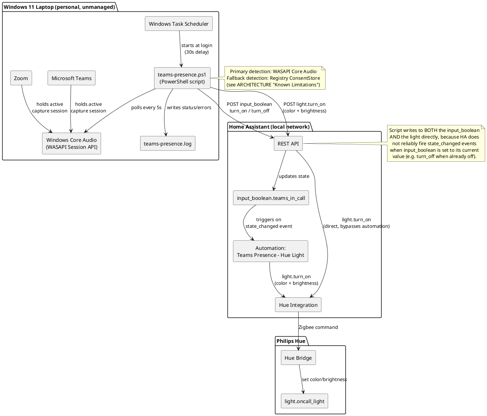
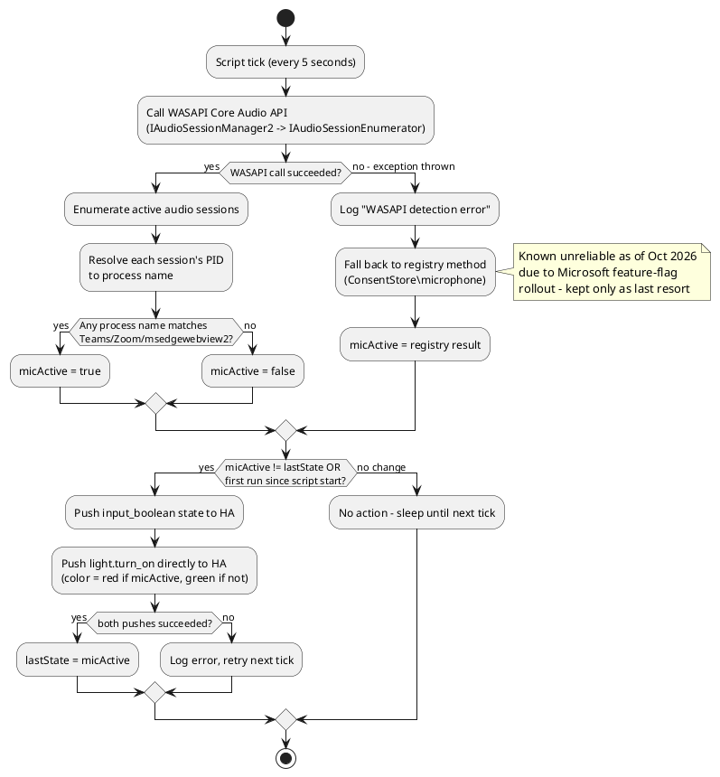

# Architecture — Teams/Zoom Presence Light

## Purpose

Provide a visual, ambient indicator (a Philips Hue bulb) that shows nearby
people whether the user is currently on a Microsoft Teams or Zoom call,
without depending on Microsoft Graph API access, corporate IT/Entra ID
app registration, or a cloud service.

## Constraints that shaped the design

- No Entra ID (Azure AD) app registration available — corporate tenant blocks
  user self-service registration, and IT declined to provision one
  (cited cost concerns, confirmed to be a misunderstanding but still a hard no)
- No access to a local Teams API or webhook — the new (2023+) Teams client
  does not expose local presence state
- Previous solution (Microsoft Store app "PresenceLight") broke when
  Microsoft changed Graph API requirements
- Personal laptop (not corporate-managed), so local scripts/scheduled tasks
  are permitted without IT restriction
- Existing Home Assistant instance with a Philips Hue integration already
  in place

---

## Solution Overview

A PowerShell script runs continuously on the user's Windows 11 laptop. It
polls the Windows Core Audio subsystem to detect whether Microsoft Teams or
Zoom currently holds an **active microphone capture session**. On every
detected state change (and once forcibly at script startup), it pushes the
status to Home Assistant via two REST calls:

1. Flips `input_boolean.teams_in_call` (for HA history, dashboards, and any
   other automations that may want to react to it)
2. Directly calls `light.turn_on` on the Hue bulb entity with the correct
   color and brightness (for guaranteed, immediate visual sync — does not
   depend on the `input_boolean`'s state-change event firing)

No cloud API, no Entra ID app registration, and no corporate IT dependency
are involved anywhere in this chain.

---

## Component Diagram



---

## Detection Logic Flow



---

## Data Flow / Message Format

The integration is intentionally simple — plain REST/JSON over HTTP on the
local network. No MQTT broker, no message queue, no persistent connection.

**Push input_boolean state:**
```
POST http://192.168.3.131:8123/api/services/input_boolean/turn_on
Authorization: Bearer <long-lived access token>
Content-Type: application/json

{ "entity_id": "input_boolean.teams_in_call" }
```

**Push light state directly:**
```
POST http://192.168.3.131:8123/api/services/light/turn_on
Authorization: Bearer <long-lived access token>
Content-Type: application/json

{
  "entity_id": "light.oncall_light",
  "color_name": "red",
  "brightness": 102
}
```

Because the pattern is plain REST, the script could be re-pointed at a
different target (MQTT broker, Node-RED webhook, Hue Bridge API directly,
etc.) by changing only the `Set-HAState` / `Set-HALight` functions — the
detection logic is completely decoupled from the notification mechanism.

---

## Why Not Microsoft Graph API?

This was the preferred approach (full Available/Busy/Away/DND presence
states, not just in-call detection) but was ruled out:

- Requires an Entra ID (Azure AD) app registration
- User self-service app registration is blocked at the tenant level
  (confirmed via direct test — `401 Insufficient privileges`)
- IT declined to create one on request, citing cost (likely a
  misunderstanding, since delegated `Presence.Read` registrations are free,
  but the answer was still no)

If this restriction is ever lifted, Graph API is the recommended upgrade
path — see BACKLOG.md.

---

## Known Limitations

1. **Binary state only** — "in a call" vs. "not in a call." No distinction
   between Available, Busy, Away, Do Not Disturb, or Presenting.
2. **Muted-but-joined calls** may not register as "in a call" if the mic
   session itself isn't held active by the app while muted (behavior can
   vary by app/version).
3. **Registry fallback is unreliable** as of October 2026 due to a Microsoft
   server-side feature-flag rollout affecting `ConsentStore` registry
   updates. WASAPI is now the primary method; registry is last-resort only.
4. **No distinction between Teams meetings and Teams calls** — any active
   mic session from a Teams/Zoom process triggers "in a call," including
   test calls, voice memos recorded in-app, etc.
5. **Single point of failure**: if the laptop is asleep, shut down, or the
   script/task isn't running, the light freezes at its last pushed state.
